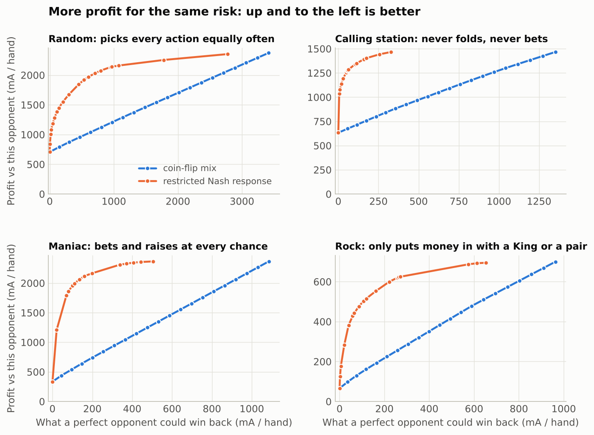
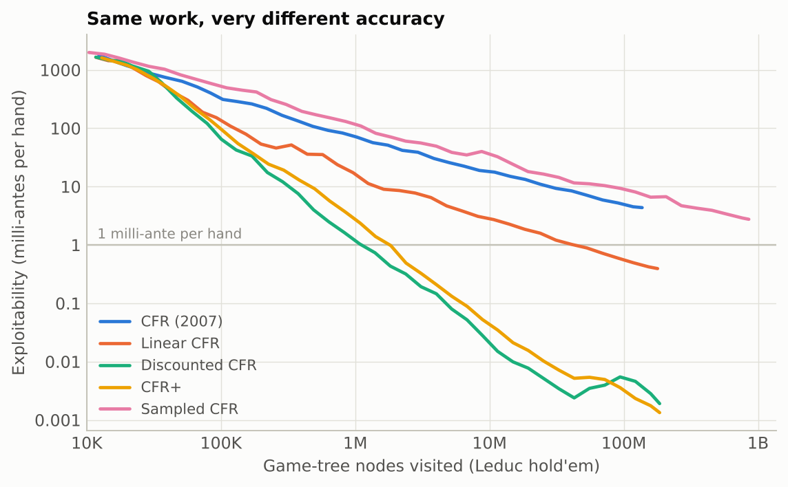
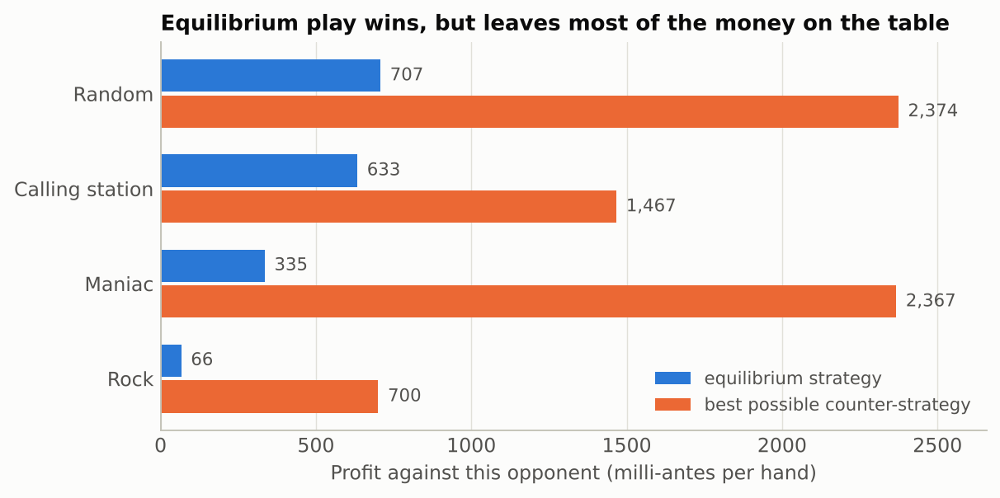

# ZeroSum

Equilibrium solvers for small poker games, and a study of what equilibrium play
gives up against opponents who make mistakes.

The core is C++20 with no dependencies: a game-tree builder, five
counterfactual-regret-minimization solvers, exact best responses, and a
restricted-Nash-response construction. A separate Python linear program solves
the same games exactly and is used only to check the solvers.

**Findings** (full write-up: [`reports/ZeroSum_Research_Memo.md`](reports/ZeroSum_Research_Memo.md), also as a [PDF](reports/ZeroSum_Research_Memo.pdf))

- Discounted CFR reached 1 milli-ante per hand of exploitability on Leduc
  hold'em in 321 iterations and 1.2 million node visits. The original CFR
  needed 842,438 iterations and 2.4 billion: **about 2,000 times the work**.
- All solvers bracket the game value the linear program computes
  (Kuhn −1/18, Leduc −0.085606424), and the linear program's strategy has
  exploitability below 10⁻⁹ milli-antes under the C++ evaluator.
- The CFR+ equilibrium beats all four weak opponent types tested but collects
  only **9% to 43%** of the available profit (the linear program's corner
  equilibrium, 5% to 41%).
- A restricted Nash response captures half of the remaining profit while taking
  on **8 to 87 times less risk** than a coin-flip mix of the equilibrium and the
  best response that earns the same amount.



## Run it

You need a C++20 compiler and `make`. Python 3 with NumPy, SciPy, and Matplotlib
is used for the linear-program check and the report.

```bash
make -j2
make test                 # 24 C++ test cases, 15 Python tests
```

Solve Leduc hold'em and look at the result:

```bash
./build/zerosum info leduc
./build/zerosum solve leduc --algo dcfr --iterations 1000 --every 250 --save leduc.txt
./build/zerosum show leduc --strategy leduc.txt | head
./build/zerosum exploit leduc --strategy leduc.txt
```

```text
iteration      250  exploitability     1.3874 mA/hand  value in [-0.087276, -0.084501]  nodes 913718
iteration      500  exploitability     0.4727 mA/hand  value in [-0.086155, -0.085209]  nodes 1836318
iteration      750  exploitability     0.2389 mA/hand  value in [-0.085838, -0.085360]  nodes 2760192
iteration     1000  exploitability     0.1755 mA/hand  value in [-0.085769, -0.085418]  nodes 3683924
```

Each line says how much a perfect opponent could win per hand against the
current strategy, and the interval that the game's true value must lie in.
Both shrink as the solver runs.

Play against it:

```bash
./build/zerosum play leduc --strategy leduc.txt
```

Check a solver against the exact answer:

```bash
./build/zerosum export leduc > leduc.json
python3 scripts/lp_oracle.py leduc.json --save leduc_lp.txt
./build/zerosum eval leduc --strategy leduc_lp.txt
```

Rebuild every number, figure, and the memo (about four minutes):

```bash
python3 -m pip install -r requirements.txt
make report
```

## The games

| Game | Rules | Information sets |
| --- | --- | ---: |
| `kuhn` | Three cards (J, Q, K), one card each, one bet of 1. Kuhn solved it by hand in 1950. | 12 |
| `leduc` | Six cards (two each of J, Q, K), one private card, one public card, two betting rounds with bets of 2 then 4, at most two bets per round. A pair beats a high card. | 288 |
| `leduc4` … `leduc13` | Leduc's rules with more ranks. | 504 … 5,148 |

Both players put in an ante of 1. All results are in **milli-antes per hand**
(mA): thousandths of that forced bet.

An *information set* is everything one player cannot tell apart: their own
card, the public card, and the betting so far. A strategy gives a probability
for each action at each information set. Leduc is often quoted as having 936
information sets; that count keeps the two suits apart. They never matter in
this game, so merging them gives 288. The tests check both counts and that both
versions have the same value.

## What is implemented

| Piece | File | Notes |
| --- | --- | --- |
| Game tree | `include/zerosum/game.hpp` | Explicit tree, chance nodes, information sets, a builder for the Kuhn/Leduc family |
| Solvers | `include/zerosum/cfr.hpp` | CFR, CFR+, Linear CFR, Discounted CFR, external-sampling Monte Carlo CFR |
| Analysis | `include/zerosum/analysis.hpp` | Expected value, exact best response, exploitability, pre-game mixing, restricted Nash response, four opponent types |
| Command line | `src/main.cpp` | `info solve eval show exploit frontier export bench play` |
| Exact check | `scripts/lp_oracle.py` | Sequence-form linear program (SciPy HiGHS) |
| Second rule set | `scripts/reference_games.py` | Kuhn and Leduc rewritten from the rules, dealing cards rather than ranks |
| Report | `scripts/build_report.py` | Runs the experiments, writes `results/`, figures, and the memo |

### The five solvers

All five repeat one idea: play the game against yourself, and at every decision
record how much better each action would have done than what you played
(the *regret*). Play actions in proportion to their accumulated positive regret.
The average strategy over all iterations converges to an equilibrium.

| `--algo` | Change from the original | Source |
| --- | --- | --- |
| `cfr` | None | Zinkevich et al., 2007 |
| `cfr+` | Regret is never allowed below zero; players update in turn; later iterations weigh more | Tammelin, 2014 |
| `lcfr` | Iteration *t* is weighted by *t* | Brown and Sandholm, 2019 |
| `dcfr` | Old positive and negative regrets are discounted at different rates | Brown and Sandholm, 2019 |
| `mccfr` | Each iteration samples one deal and one opponent line instead of walking the whole tree | Lanctot et al., 2009 |

## Results

Work to reach 1 mA per hand on Leduc, each with the same budget of node visits
(`results/bench.csv`):

| Algorithm | Reached | Iterations | Node visits | Less work than CFR |
| --- | --- | ---: | ---: | ---: |
| CFR | yes | 842,438 | 2,368,783,718 | 1× |
| Linear CFR | yes | 11,515 | 40,632,503 | 58× |
| Discounted CFR | yes | 321 | 1,175,470 | 2,015× |
| CFR+ | yes | 470 | 1,737,984 | 1,363× |
| Sampled CFR | no (1.4 mA at 4 billion) | | | |

Node visits are counted, not timed, so these ratios do not depend on how fast
the machine is. The exact stopping iteration is sensitive to the last bit of
floating-point arithmetic, so the build disables fused multiply-add
(`-ffp-contract=off`) to make GCC and Clang, x86 and ARM, do the same
arithmetic. GCC 13 and Clang 18 on x86-64 give identical counts.



Against four simple opponents, using the CFR+ equilibrium (`results/exploit.csv`):

| Opponent | Equilibrium earns | Best counter earns | Share captured |
| --- | ---: | ---: | ---: |
| Random | 707 | 2,374 | 30% |
| Calling station (never folds or bets) | 633 | 1,467 | 43% |
| Maniac (always bets or raises) | 335 | 2,367 | 14% |
| Rock (only plays a King or a pair) | 66 | 700 | 9% |



The best counter-strategy is fragile: the one that takes 700 mA from the Rock
loses 963 mA per hand to a perfect opponent. The memo's section 4 shows how the
restricted Nash response keeps most of the profit at a fraction of that risk.

## Why the answers can be trusted

- **An independent exact method.** `scripts/lp_oracle.py` solves each game as a
  linear program. It shares no code and no algorithm with the solvers. Every
  solver's value bracket contains the LP value, and the LP's strategy has
  exploitability below 10⁻⁹ mA when evaluated by the C++ code.
- **The rules written twice.** `scripts/reference_games.py` builds Kuhn and
  Leduc from the published rules by dealing cards from a deck; the C++ builder
  deals ranks with probabilities. Both produce the same information sets and
  the same value to ten digits.
- **Known answers.** Kuhn's value is −1/18. Each of Kuhn's hand-derived
  equilibria has exploitability zero to machine precision, and every solver's
  output satisfies his three relations between bluffing and calling frequencies.
- **Properties, not just examples.** On random strategies the tests check that
  a best response achieves its stated value and is never beaten, that the value
  bracket always contains the true value, and that mixing two strategies before
  the hand mixes their payoffs exactly.
- **Sanitizers.** `make sanitize` runs the C++ tests under AddressSanitizer and
  UndefinedBehaviorSanitizer.

## Commands

```text
zerosum info GAME
zerosum solve GAME [--algo cfr+] [--iterations 1000] [--every N | --growing] [--seed 1] [--save FILE] [--csv]
zerosum eval GAME --strategy FILE
zerosum show GAME --strategy FILE
zerosum exploit GAME --strategy FILE [--csv]
zerosum frontier GAME --strategy FILE --opponent random|station|maniac|rock [--steps 20] [--iterations 1000]
zerosum export GAME
zerosum bench GAME [--target 1.0] [--max-nodes 4e9] [--trials 3]
zerosum play GAME --strategy FILE [--seat 0] [--seed 1]
```

A strategy file is plain text, one line per action: `infoset action probability`.
An information set is written `player:card:public card:betting`, for example
`0:K:J:kb/b` (first player, holding a King, Jack on the board, check-bet in the
first round, then a bet in the second). Actions are `k` check, `b` bet, `f`
fold, `c` call, `r` raise.

## Limits

- These are research-sized games. Leduc has 288 information sets; heads-up
  no-limit hold'em has roughly 10¹⁶¹. This is not a poker bot.
- The weak opponents are fixed and known exactly. Estimating an opponent from a
  finite sample of hands is a different and harder problem.
- The tree is stored in memory. Abstraction, depth-limited solving, and learned
  value functions, which are what make large games tractable, are not here.
- Wall-clock timings were taken on a shared two-core cloud machine and have not
  been re-measured on other hardware.

## Layout

```text
include/zerosum/   game.hpp  cfr.hpp  analysis.hpp
src/main.cpp       command line
tests/             test_core.cpp (C++)   test_cli.py (CLI and LP cross-check)
scripts/           lp_oracle.py  reference_games.py  build_report.py
results/           CSV output of the experiments and the solved strategies
reports/           the memo and its figures
docs/              interview guide, resume entry, Mac and GitHub setup
```

MIT license.
